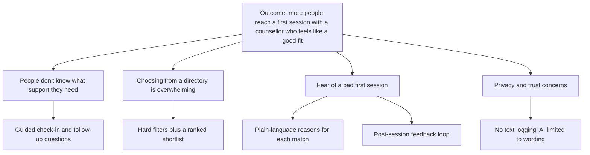
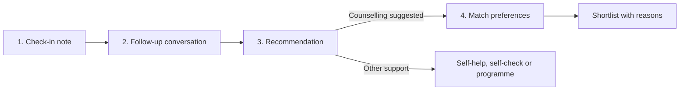

# Case study: From "I'm not sure what I need" to a well-fitting counsellor

A product management case study built around the YourDOST Wellbeing Navigator prototype.

> **Honesty note.** This is a prototype case study. There are no real users, no real provider data and no validated outcomes. Everything labelled *hypothesis* or *assumption* is a reasoned starting point to be tested, not a finding. Numbers in the prioritisation tables are illustrative, so you can see the method, and are not measurements.

**Contents**

1. [Summary](#1-summary)
2. [Context and problem](#2-context-and-problem)
3. [Users and jobs to be done](#3-users-and-jobs-to-be-done)
4. [Opportunity and strategy](#4-opportunity-and-strategy)
5. [The solution](#5-the-solution)
6. [Key product decisions and trade-offs](#6-key-product-decisions-and-trade-offs)
7. [Success metrics](#7-success-metrics)
8. [Prioritisation and roadmap](#8-prioritisation-and-roadmap)
9. [Risks, ethics and safety](#9-risks-ethics-and-safety)
10. [Experiment plan](#10-experiment-plan)
11. [What I would do next and what I learned](#11-what-i-would-do-next-and-what-i-learned)

Frameworks used here are explained, with templates, in [`frameworks.md`](./frameworks.md). A presentable version of this story is in [`keynote.md`](./keynote.md).

---

## 1. Summary

| | |
| --- | --- |
| **Product** | A private check-in that suggests a next step for wellbeing and, where counselling fits, matches the person to counsellor profiles |
| **Setting** | Employee wellbeing (a workplace programme), a B2B2C shape |
| **Core problem** | People who might benefit from support often don't know what kind they need, and face a high-effort, high-stakes choice when picking a counsellor |
| **Bet** | A short, gentle conversation plus an explainable, preference-based match lowers the barrier to a first session that feels like a good fit |
| **What was built** | A four-stage journey, a rule-based recommendation engine, an explainable matching engine, optional AI wording, and unit tests |
| **Key principle** | AI helps with words. Deterministic, auditable rules make the decisions |

## 2. Context and problem

### The situation

Workplace wellbeing programmes usually offer a mix of resources: self-help content, self-checks, structured programmes and access to counsellors. Employees see this as a menu, and menus fail people who are stressed, unsure what they need, or worried about being judged.

### The problem statement

> Employees who are struggling often don't know which kind of support to try, and those who are open to counselling face an overwhelming, high-stakes choice of provider. The result is people who disengage before a first session, or who book a session that isn't a good fit and conclude that counselling "doesn't work for them".

### Why it matters (hypotheses to validate)

- **For the employee:** the first step is the hardest. A mismatch at that point can put someone off getting help for a long time.
- **For the programme owner:** unused benefits and first sessions that don't lead to a second.
- **For counsellors:** a better-informed client arrives, with a clear sense of what they want from sessions.

### What this is *not*

A clinical tool. It does not diagnose, score severity, or replace professional judgement. Making that boundary explicit is a product decision, not just a disclaimer (see [section 9](#9-risks-ethics-and-safety)).

## 3. Users and jobs to be done

### Primary persona (hypothesis)

**"Meera", early-career employee, stressed and unsure.** She has felt on edge for a few weeks. She isn't in crisis and doesn't think of it as "a mental health problem". She would rather not discuss it with her manager. She might talk to someone but doesn't know where to start, and worries about picking the wrong person.

### Secondary personas (hypotheses)

| Persona | Situation | What they need |
| --- | --- | --- |
| **Arjun**, mid-career, long-standing stress | Has been coping for months, practical, sceptical about "just talking" | Practical strategies, structure, a goal-focused approach |
| **Kavya**, prefers her home language | Would open up more in Tamil or Kannada | Language fit as a non-negotiable |
| **The reluctant user** | Says "not right now" to a counsellor | Not to be pushed; a respectful alternative |

### Jobs to be done

Written in the JTBD format: *When [situation], I want to [motivation], so I can [outcome].*

1. **Make sense of it.** When I feel off but can't explain why, I want to put it into words safely, so I can understand what kind of help might fit.
2. **Choose without being pressured.** When I'm weighing up support, I want a recommendation I can accept or decline, so I stay in control.
3. **Find someone I can talk to.** When I'm ready to speak to a professional, I want a shortlist that fits my language, format and style, so I don't have to research a long list.
4. **Trust the process.** When I share something personal, I want to know how it is used, so I can be honest without worrying.

### Hiring and firing criteria

People "hire" this product when it feels **private, short and non-judgemental**. They would "fire" it if it feels like a clinical screening form, asks for too much, or pushes them towards a decision.

## 4. Opportunity and strategy

### Opportunity Solution Tree

### Strategic choices

| Choice | Decision | Why |
| --- | --- | --- |
| Who decides? | **Rules decide, AI explains** | Auditability, predictability and trust in a sensitive domain |
| Push or pull? | **Suggest, never push** | Autonomy matters for willingness to seek help |
| Breadth of matching | **Few preferences, clear logic** | Fewer questions means less drop-off; clear logic means explainable results |
| Claims | **Say "a good place to start", not "the perfect match"** | Matching quality is unvalidated, so we shouldn't promise it |

## 5. The solution

### The journey

### Stage by stage

| Stage | What the user does | Product behaviour |
| --- | --- | --- |
| **Check-in** | Writes what's been going on in their own words | Private note; the text is not logged |
| **Conversation** | Answers up to four gentle questions (duration, impact, helpful support, openness to a counsellor) | Skips the duration question if the note already covered it |
| **Recommendation** | Sees a suggested next step with a reason | Deterministic rules choose from four options; AI can only phrase the summary |
| **Matching** | Chooses language, session mode, style and availability | Filters out profiles that can't meet hard needs, then ranks the rest |

### Recommendation logic (summary)

The engine maps answers to one of four catalogue options: self-help exercise, wellbeing self-check, guided programme, or counselling. For example:

- High impact *and* openness to a counsellor leads to **counselling**.
- Wanting to "understand what I'm experiencing", or being unsure, leads to a **self-check**.
- Wanting practical strategies with a long duration leads to a **programme**; with a short duration, a **self-help exercise**.
- If someone says "Not right now" to a counsellor, counselling is hidden from the alternatives. If their impact is "Significantly", the explanation adds that human support remains an option.

### Matching logic (summary)

1. **Gate:** matching only opens when counselling is the primary recommendation.
2. **Hard filters:** language, session mode, availability.
3. **Weighted score:** concern fit 40%, experience 25%, style fit 20%, availability fit 15%.
4. **Explanation:** every match carries a written reason, including what did *not* contribute.

See the README for the full table and the code in `lib/matching/engine.ts`.

## 6. Key product decisions and trade-offs

Each decision is written the way it could be argued in a design review.

### D1. Deterministic engine, AI for wording only

- **Options:** (a) LLM decides the recommendation and match; (b) rules decide, LLM paraphrases; (c) no AI.
- **Chosen:** (b).
- **Why:** In a wellbeing context the cost of an unpredictable or unexplainable decision is high. Rules can be reviewed by clinicians, tested and audited. AI adds warmth in the summary without owning the outcome.
- **Trade-off:** less flexible than free-text AI reasoning, and rules must be maintained by hand.
- **Revisit when:** there is real outcome data and a safe evaluation setup to test a learned ranker against the rules.

### D2. Hard filters before soft scoring

- **Why:** A profile that can't speak the user's language or offer their session mode is not "a lower match", it's not a match. Ranking it at all wastes attention and erodes trust.
- **Trade-off:** over-filtering can leave an empty or short list. Mitigation: "No preference" and "Flexible" options relax the filters.

### D3. Neutral concern fit when the signal is weak

- **Why:** If no reliable concern themes are detected from the note, the engine scores concern fit at a neutral 0.5 and says so, instead of guessing and quietly biasing the ranking.
- **Principle:** *Don't manufacture confidence you don't have.*

### D4. Experience gets a weight, and the weight is flagged as an assumption

- **Why include it:** Experience is a legitimate part of how people choose.
- **Why flag it:** Years of experience is not a measure of quality or outcomes. The product copy states this on every match.
- **Revisit when:** real feedback data lets us test whether experience predicts a good fit at all, and drop or reduce the weight if not.

### D5. Fewer questions, with an escape hatch

- **Why:** Each additional question costs completions. The product asks at most four follow-ups and four preferences, and skips redundant ones.
- **Escape hatch:** "Not right now", "I'm not sure", "No preference" and "Flexible" are first-class answers.

### D6. Feedback demo is separate from scoring

- **What it is:** a panel showing how post-session feedback (felt understood, willing to continue, approach fit) *could* be reviewed, using synthetic data.
- **Why separate:** It demonstrates the learning loop without letting unvalidated data influence real rankings. It is clearly marked as synthetic.

## 7. Success metrics

### North Star (proposed)

> **Share of matched users whose first session leaves them feeling understood.**

It combines access (they booked and attended) with quality (the session felt right), and it is the outcome the whole product exists to improve. Self-reported "felt understood" is a proxy, not a clinical outcome.

### Metric tree

| Level | Metric | Why |
| --- | --- | --- |
| **North Star** | First sessions where the user felt understood, as a share of matched users | The outcome |
| **Input: activation** | Check-in start to completion rate | Is the entry point approachable? |
| **Input: engagement** | Conversation and preference completion rate | Is the question count tolerable? |
| **Input: conversion** | Counselling recommendation to match view to booking intent | Is the shortlist compelling? |
| **Input: quality** | Felt understood, willing to continue, approach fit (good, mixed, poor) | Is the match any good? |
| **Guardrail: safety** | Handling of crisis signals; opt-outs | We never trade safety for conversion |
| **Guardrail: trust** | Privacy complaints; users reporting the explanation felt wrong | Trust is the product |
| **Guardrail: fairness** | Match quality and empty-list rate across language and demographic groups | Avoid a system that works for some groups only |

### HEART view

| Dimension | Signal |
| --- | --- |
| **Happiness** | Felt understood; satisfaction with the shortlist |
| **Engagement** | Questions answered; return visits |
| **Adoption** | New users who start a check-in |
| **Retention** | Willing to continue; second-session rate |
| **Task success** | Reached a recommendation; reached a shortlist; empty-list rate |

### Measurement caveat

Before any real launch, define what is measured without reading private note text. Prefer aggregate, consented signals, and decide the retention and access rules up front.

## 8. Prioritisation and roadmap

### RICE (illustrative numbers)

*Reach* = users per quarter affected (assumes 1,000 check-ins, about 300 reaching matching). *Impact* = 0.25 minimal, 0.5 low, 1 medium, 2 high, 3 massive. *Confidence* = %. *Effort* = person-months. **RICE = Reach × Impact × Confidence ÷ Effort.**

| # | Initiative | Reach | Impact | Confidence | Effort | RICE |
| --- | --- | --- | --- | --- | --- | --- |
| 1 | Safety triage and crisis escalation path | 1,000 | 3 | 80% | 2 | **1,200** |
| 2 | Replace fictional profiles with real provider data | 300 | 3 | 80% | 4 | **180** |
| 3 | Extra preference filters (for example counsellor gender, if the user wants it) | 300 | 1 | 50% | 1 | **150** |
| 4 | Post-session feedback loop feeding the ranking | 300 | 2 | 50% | 3 | **100** |
| 5 | Booking integration | 300 | 2 | 80% | 5 | **96** |
| 6 | Self-help and programme content library | 700 | 1 | 50% | 4 | **87.5** |

**Reading the table:**

- Item 1 scores highest, and it's also a **launch gate**, not a feature to trade off. RICE is a ranking tool, not a way to decide whether safety is optional.
- Item 2 is a prerequisite for item 4 (there's nothing real to learn from until providers are real).
- Low-confidence items (3, 4, 6) point to research or experiments first, not build.

### Phased roadmap (Now, Next, Later)

| Horizon | Theme | Contents |
| --- | --- | --- |
| **Now** | Be safe and testable | Safety triage and crisis path; moderated usability testing of the prototype; clinical review of copy and rules |
| **Next** | Make it real | Real provider data and availability; booking; baseline metrics and consented analytics |
| **Later** | Learn and improve | Feedback loop into ranking; fairness audits; test a learned ranker against rules; programme and content expansion |

### Kano view

| Category | Features |
| --- | --- |
| **Must-have** | Privacy, clear "not clinical" boundary, crisis path, language and mode filtering |
| **Performance** | Fewer questions, better concern fit, faster availability |
| **Delighters** | Plain-language reasons for each match, skipping questions you've already answered |

## 9. Risks, ethics and safety

### Risk register

| Risk | Likelihood | Impact | Mitigation |
| --- | --- | --- | --- |
| A user in crisis uses a non-crisis flow | Medium | Severe | Crisis signal detection and escalation path before launch; clear scope copy |
| Users read "match" as clinical endorsement | Medium | High | Honest language ("a good place to start"); disclaimers on each match |
| Concern tagging misreads the note | Medium | Medium | Neutral fit when unreliable; explanation shows what was and wasn't used |
| Ranking bias across languages or groups | Medium | High | Fairness audits; monitor empty-list rate by group |
| Experience weight rewards seniority, not fit | Medium | Medium | Flagged assumption; test and reduce with real data |
| Privacy breach or perceived surveillance | Low | Severe | No logging of note text; AI limited to wording; transparent data policy |
| AI wording sounds clinical or over-confident | Low | Medium | AI cannot choose the outcome; fallback summary; copy review |

### Pre-mortem

*Imagine it's a year after launch and the product failed. Why?*

1. People didn't trust it with something personal, and completion was low.
2. The shortlist felt generic, so nobody booked.
3. A user in distress was handled badly, and trust collapsed.
4. Employers saw it as monitoring, and employees stopped using it.

Each of these maps to a design choice already in the product (privacy, explainable reasons, scope boundary) or to a "Now" roadmap item (safety triage).

### Principles the product follows

- **Autonomy:** the user can decline, skip and say "not right now".
- **Transparency:** every recommendation and match explains itself.
- **Humility:** "illustrative", "not validated", "not clinical" appear where they matter.
- **Minimal data:** collect what's needed, don't log free text.
- **Human in the loop:** the aim is to get someone to a human professional, not to replace one.

## 10. Experiment plan

| # | Hypothesis | Method | Success signal | Decision it informs |
| --- | --- | --- | --- | --- |
| E1 | A short check-in feels safer than browsing a directory | Moderated usability test, 6 to 8 participants | Participants describe it as private and low-pressure; most finish unaided | Keep or cut the free-text step |
| E2 | Explaining *why* a match was suggested increases willingness to book | A/B: with vs without reasons | Higher booking intent with reasons | Keep the explanation depth |
| E3 | Four preferences are enough | Funnel analysis by step | Drop-off per question stays low | Add or remove a question |
| E4 | Experience weight (25%) helps rather than hurts fit | Compare weight variants against felt-understood data | Better felt-understood at lower or zero weight would justify removing it | Reweight the score |
| E5 | Showing 3 featured matches beats a longer list | A/B on list length | Higher booking rate, no drop in satisfaction | Keep the shortlist size |

Start with E1 and E2. They're cheap and answer the biggest question: does this reduce the barrier at all?

## 11. What I would do next and what I learned

### Next steps

1. Run E1 with real people from the target group.
2. Commission clinical and ethical review of the rules, copy and safety scope.
3. Build the safety triage path.
4. Plan the data and consent model before connecting real providers.

### What I learned

- **In sensitive domains, restraint is a feature.** The most valuable decisions were what *not* to do: not diagnose, not let AI decide, not claim a "perfect" match.
- **Explainability is a product requirement, not a nice-to-have.** Writing the reason for each match forced clarity about what the algorithm actually does.
- **Label assumptions loudly.** The 25% experience weight is a guess. Marking it as one keeps it honest and gives a clear experiment to run.
- **Prioritisation frameworks need judgement on top.** RICE ranked safety first, but safety is a gate, not a score.
- **Prototype data teaches process, not truth.** The synthetic feedback panel shows *how* we would learn, without pretending we already have.
