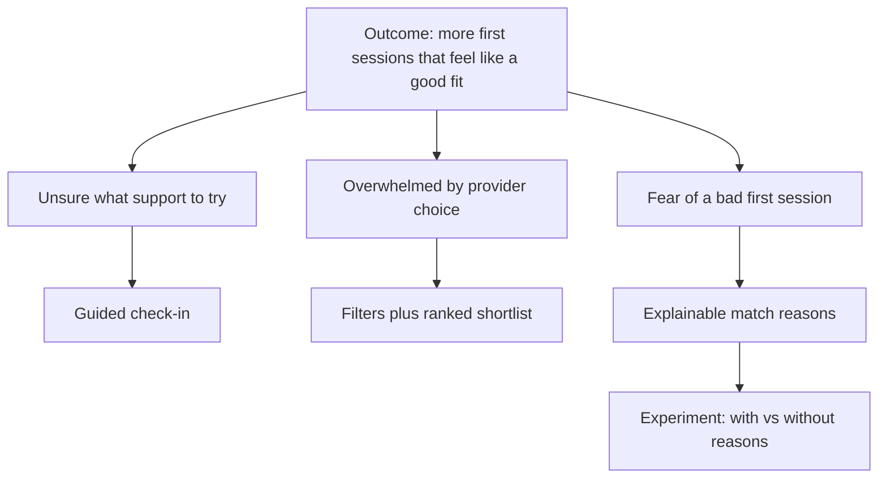

# PM frameworks toolkit

A practical playbook of product management frameworks. Each one has four parts: **what it is**, **when to use it**, **how it applies to the Wellbeing Navigator**, and **a template** you can copy.

> The worked examples reuse this prototype. Their numbers and personas are hypotheses for teaching the method, not research findings. See [`case-study.md`](./case-study.md) for the full story.

**Index**

| Stage | Frameworks |
| --- | --- |
| Discover | [Problem statement](#1-problem-statement) · [Jobs to be done](#2-jobs-to-be-done-jtbd) · [Personas](#3-lean-personas) · [How might we](#4-how-might-we-hmw) |
| Define | [Opportunity solution tree](#5-opportunity-solution-tree) · [Kano model](#6-kano-model) · [Assumption mapping](#7-assumption-mapping) |
| Prioritise | [RICE](#8-rice) · [MoSCoW](#9-moscow) · [Impact vs effort](#10-impact-vs-effort) |
| Measure | [North Star](#11-north-star-metric) · [HEART](#12-heart) · [AARRR](#13-aarrr-pirate-metrics) · [Guardrails](#14-guardrail-metrics) |
| Decide and de-risk | [Decision record](#15-decision-record) · [Pre-mortem](#16-pre-mortem) · [Risk matrix](#17-risk-matrix) · [Responsible AI checklist](#18-responsible-ai-checklist) |
| Plan and communicate | [Now, Next, Later](#19-now-next-later-roadmap) · [Lightweight PRD](#20-lightweight-prd) · [Experiment card](#21-experiment-card) · [Stakeholder map](#22-stakeholder-map) |

---

## Discover

### 1. Problem statement

**What it is:** A short, testable description of who has what problem, why it matters and what is different about today's alternatives.

**Use it when:** The team jumps to solutions, or different people describe the problem differently.

**Applied:**
> Employees who are struggling often don't know which kind of support to try, and those open to counselling face an overwhelming choice of provider. Many disengage before a first session or book one that isn't a good fit.

**Template:**
```
[Who] struggles to [do what] because [root cause].
This leads to [consequence], which matters because [impact].
Today they [current workaround], which falls short because [gap].
```

**Good-problem test:** Can you observe it? Can you measure it? Is it about the user, not the solution?

### 2. Jobs to be done (JTBD)

**What it is:** Frame demand as the "job" a person hires a product to do, in a situation, with a desired outcome.

**Use it when:** You need to understand motivation beyond demographics.

**Applied:**

| Situation | Motivation | Outcome |
| --- | --- | --- |
| I feel off but can't explain why | Put it into words safely | Understand what kind of help fits |
| I'm weighing up support | Get a recommendation I can decline | Stay in control |
| I'm ready to talk to a professional | Get a shortlist that fits my needs | Skip long research |

**Template:**
```
When [situation],
I want to [motivation],
so I can [expected outcome].
Anxieties: [what might stop me]   Habits: [what I do today]
```

### 3. Lean personas

**What it is:** A one-page description of a target user centred on context and needs, not demographics alone.

**Applied:** "Meera": early-career, stressed for weeks, unsure where to start, wary of being judged. Needs privacy, low effort, a no-pressure suggestion.

**Template:**
```
Name / role:
Context (when and where they'd use this):
Goals:
Frustrations:
What would make them trust this:
Evidence level: [assumption / interview / data]
```

**Tip:** Always record the evidence level. A persona with no evidence is a hypothesis.

### 4. How might we (HMW)

**What it is:** Turn problems into open, optimistic design questions.

**Applied:**
- How might we help someone describe what they feel without a clinical form?
- How might we show *why* a counsellor was suggested, in plain language?
- How might we make "not right now" a respected answer?
- How might we learn whether a match was good without reading private notes?

**Template:** `How might we [verb] [user] [outcome] without [constraint]?`

---

## Define

### 5. Opportunity solution tree

**What it is:** A tree from a desired outcome to opportunities (user needs) to solutions to experiments (Teresa Torres).

**Use it when:** You have many ideas and need to see how they connect to an outcome.

**Applied:**



**Rule of thumb:** One outcome at the root. Compare at least three solutions per opportunity before committing.

### 6. Kano model

**What it is:** Classifies features by how they affect satisfaction: **must-haves** (absence hurts), **performance** (more is better) and **delighters** (unexpected joy).

**Applied:**

| Type | Examples |
| --- | --- |
| Must-have | Privacy, "not clinical" boundary, crisis path, language filter |
| Performance | Fewer questions, better concern fit |
| Delighter | Plain-language reasons, skipping questions already answered |

**Caution:** In sensitive domains, "delighters" never replace must-haves. Ship safety before sparkle.

### 7. Assumption mapping

**What it is:** List the assumptions your idea depends on, then place them on a grid of **importance** and **evidence**. Test the important, unproven ones first.

**Applied:**

| Assumption | Importance | Evidence | Action |
| --- | --- | --- | --- |
| Users will write a free-text note | High | None | Usability test (E1) |
| Explanations raise willingness to book | High | None | A/B test (E2) |
| Experience predicts fit | Medium | None | Test with real feedback (E4) |
| Four preferences are enough | Medium | None | Funnel analysis (E3) |

**Template:** four quadrants: *Test now* (high importance, low evidence), *Monitor* (high, high), *Park* (low, low), *Ignore* (low importance, high evidence).

---

## Prioritise

### 8. RICE

**What it is:** `RICE = (Reach × Impact × Confidence) ÷ Effort`.

**Applied** (illustrative numbers):

| Initiative | Reach | Impact | Conf. | Effort | RICE |
| --- | --- | --- | --- | --- | --- |
| Safety triage and crisis path | 1,000 | 3 | 80% | 2 | 1,200 |
| Real provider data | 300 | 3 | 80% | 4 | 180 |
| Extra preference filters | 300 | 1 | 50% | 1 | 150 |
| Feedback loop into ranking | 300 | 2 | 50% | 3 | 100 |
| Booking integration | 300 | 2 | 80% | 5 | 96 |
| Content library | 700 | 1 | 50% | 4 | 87.5 |

**Pitfalls:** Confidence is often inflated. Effort is often underestimated. Safety and compliance are gates, not scores.

### 9. MoSCoW

**What it is:** Sort scope into **Must**, **Should**, **Could**, **Won't (this time)**.

**Applied (for a first real launch):**

| Bucket | Items |
| --- | --- |
| Must | Crisis path, privacy model, real provider data, clinical review |
| Should | Booking, consented analytics |
| Could | Extra preference filters, content library |
| Won't (yet) | AI-chosen matches, diagnostic screening |

### 10. Impact vs effort

**What it is:** A 2×2 for quick triage. Do high-impact, low-effort first; question high-effort, low-impact.

**Applied:** Extra preference filters (low effort, medium impact) are a quick win. Booking integration (high effort, high impact) needs a plan. A content library (high effort, medium impact) can wait.

---

## Measure

### 11. North Star metric

**What it is:** One metric that captures the core value delivered, supported by input metrics the team can move.

**Applied:** *Share of matched users whose first session leaves them feeling understood.*

**Check it:** Does it reflect user value? Is it measurable? Does it lead to business value? Can the team influence it? Is it hard to game?

**Template:**
```
North Star:
Inputs (breadth, depth, frequency, efficiency):
Guardrails:
```

### 12. HEART

**What it is:** Google's UX metric framework: **H**appiness, **E**ngagement, **A**doption, **R**etention, **T**ask success. Use Goals, Signals, Metrics for each.

**Applied:**

| Dimension | Goal | Signal | Metric |
| --- | --- | --- | --- |
| Happiness | Feel understood | Post-session response | % felt understood |
| Engagement | Finish the flow | Questions answered | Completion rate |
| Adoption | Start a check-in | New users | Check-in starts |
| Retention | Continue support | Second session intent | % willing to continue |
| Task success | Get a shortlist | Reached matching | Shortlist rate, empty-list rate |

### 13. AARRR (pirate metrics)

**What it is:** Acquisition, Activation, Retention, Referral, Revenue. Best for growth funnels.

**Applied (adapted to B2B2C wellbeing):**

| Stage | Meaning here |
| --- | --- |
| Acquisition | Employee discovers the navigator through the programme |
| Activation | Completes the check-in and sees a recommendation |
| Retention | Returns, or continues to a second session |
| Referral | Recommends it to a colleague (use carefully; privacy) |
| Revenue | Programme renewal and utilisation at the employer level |

**Caution:** In wellbeing, optimising for "engagement" can become harmful. Prefer outcome-centred measures.

### 14. Guardrail metrics

**What it is:** Metrics that must *not* get worse while you optimise something else.

**Applied:** crisis-signal handling; opt-outs; privacy complaints; empty-list rate by language group; "the explanation felt wrong" reports.

**Rule:** Define guardrails before running experiments, and agree in advance what breach stops a launch.

---

## Decide and de-risk

### 15. Decision record

**What it is:** A short log of a decision, so the team remembers why.

**Applied (D1):**

```
Decision: Rules decide the recommendation and match; AI only phrases the summary.
Context: Sensitive domain; need auditability and predictability.
Options: LLM decides / Rules decide + LLM wording / No AI.
Chosen: Rules decide + LLM wording.
Consequences: Less flexible; rules need manual upkeep; easier to review and test.
Revisit when: There is real outcome data and a safe way to evaluate a learned ranker.
```

### 16. Pre-mortem

**What it is:** Imagine the launch failed. List why. Then fix the causes now.

**Applied:** Low trust (privacy), generic shortlist (explanations, better data), mishandled crisis (safety path), perceived monitoring (transparent data rules).

**Template:** `It's [date]. The product failed. The top reasons are... For each: how likely, how severe, what do we do now?`

### 17. Risk matrix

**What it is:** Plot risks by likelihood and impact to decide where to spend mitigation effort.

| | Low impact | Medium impact | High impact |
| --- | --- | --- | --- |
| **High likelihood** | Monitor | Mitigate | Mitigate first |
| **Medium likelihood** | Accept | Mitigate | Mitigate |
| **Low likelihood** | Accept | Monitor | Plan contingency |

### 18. Responsible AI checklist

Use it before any AI feature ships.

- [ ] **Purpose:** is AI needed here, and is the task low-stakes enough?
- [ ] **Authority:** does a human or an auditable rule own the decision?
- [ ] **Transparency:** does the user know where AI is used?
- [ ] **Data:** is the minimum data used? Is private text logged or retained?
- [ ] **Failure mode:** what happens if the AI is wrong, slow or unavailable? (This product falls back to a plain summary.)
- [ ] **Bias:** has output been checked across languages and groups?
- [ ] **Safety:** are crisis and harm scenarios handled outside the AI?
- [ ] **Claims:** do we avoid implying clinical validity?

---

## Plan and communicate

### 19. Now, Next, Later roadmap

**What it is:** A roadmap organised by certainty instead of dates.

| Now | Next | Later |
| --- | --- | --- |
| Safety triage; usability tests; clinical review | Real provider data; booking; consented analytics | Feedback loop into ranking; fairness audits; learned-ranker test |

### 20. Lightweight PRD

```
Title:
Problem and evidence:
Goal and success metrics (North Star, inputs, guardrails):
Users and jobs:
Scope (in) / Non-goals (out):
User flow:
Requirements (Must / Should / Could):
Risks, ethics, safety:
Open questions:
Launch and rollback plan:
```

**Applied (extract for the matching stage):**

| | |
| --- | --- |
| **Goal** | More first sessions that feel like a good fit |
| **In scope** | Preference questions, hard filters, ranked shortlist, per-match reasons |
| **Non-goals** | Diagnosis, booking, AI-chosen matches |
| **Must** | Filters respect hard needs; reasons shown; scope disclaimer; neutral scoring when the concern signal is weak |
| **Open questions** | Right number of featured matches? Does experience weight help? How do we get consented feedback? |

### 21. Experiment card

```
Hypothesis: We believe [change] will cause [outcome] for [who].
Method:
Metric and success threshold:
Guardrails:
Sample and duration:
Decision: If true we will... If false we will...
```

### 22. Stakeholder map

| Stakeholder | Cares about | Risk if ignored |
| --- | --- | --- |
| Employee (end user) | Privacy, respect, a good first session | Doesn't use it |
| Counsellor | Appropriate referrals, fair visibility | Disengages; fairness concerns |
| Programme owner (HR) | Utilisation, outcomes, cost | No renewal |
| Clinical advisor | Safety, scope, ethics | Unsafe or non-credible product |
| Legal and privacy | Data protection, claims | Compliance exposure |
| Engineering | Maintainable rules, tests | Fragile system |

---

## How to use this toolkit

1. **Start with the problem** (1 to 4), then check it against reality with people.
2. **Map opportunities** (5 to 7) before choosing solutions.
3. **Prioritise** (8 to 10) and note what's a gate, not a score.
4. **Define success and guardrails** (11 to 14) before building.
5. **De-risk** (15 to 18) when the stakes are high.
6. **Communicate** (19 to 22) in the format your audience uses.

Frameworks are thinking aids. They don't replace talking to users, and none of them should be used to justify a decision that has already been made.
